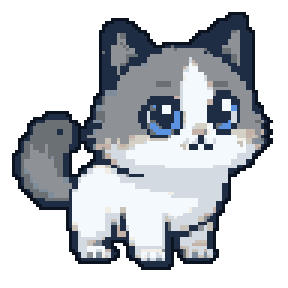

# Famling — 汀岚 / 布偶猫 / 金毛 桌宠（pet-only 完整可执行源码）

<p align="center">
  <a href="https://github.com/PerryLink/famling/actions/workflows/build-windows.yml"></a>
  <a href="https://github.com/PerryLink/famling/releases"></a>
  <a href="https://www.npmjs.com/package/dsh-famling"></a>
  <a href="LICENSE"></a>
</p>

> **状态：C1 unsigned 邀请 beta（研究原型）。** 无 Authenticode 签名、无自动更新、无公开商店、无生产 DLC 根；本仓不声称已合规或可公开发布。
> **非官方项目，不关联 DeepSeek。** 内容/角色为原创或已登记来源，AI 生成资产按仓内 AI-PROVENANCE 标注。

Famling 是一个 Windows 桌面像素桌宠 + DSH（DeepSeek Harness）客户端插件：480×336 无边框置顶小窗、三套 96×96 像素角色、四层缩放、存档自动保存与坏档恢复、内容角色包（安装/回滚/热切换）、低打扰安静时段与健康提醒。

## 30 秒开始

### A. Windows 桌面版（unsigned，推荐）

1. 打开 [Releases](https://github.com/PerryLink/famling/releases) 下载最新的 `Famling_*_x64-setup.exe`（或 `Famling_*_x64-portable.zip`）。
2. 运行安装器。**产物未签名**：SmartScreen 提示时选「更多信息 → 仍要运行」；SHA256 校验值随 Release 提供。
3. 这是透明的 480×336 置顶小窗：点角色互动，右键角色（或 Shift+F10）打开菜单；设置里可调低打扰、缩放、音色与数据边界。

### B. 作为 DSH 插件（最轻量）

```sh
dsh plugin --profile web add dsh-famling
```

插件在 DSH 左下角账号信息下方显示 72px 桌宠；默认零常驻按钮，右键或 Shift+F10 打开菜单。npm 最新发布：`dsh-famling@0.13.4`（[npm](https://www.npmjs.com/package/dsh-famling)；见 [dsh-famling repo](https://github.com/PerryLink/dsh-famling)）。

### C. 从源码跑（浏览器开发模式）

```sh
npm ci
npm run dev
# 打开 http://localhost:5173/pet.html?hero=1（不加 ?hero=1 时显示折纸 PAGEFOLD 兜底形态）
```

Tauri 桌面版构建需要 Node ≥22.16、Rust MSVC、Visual Studio Build Tools 与 WebView2：

```sh
npm ci && npm run build
cd app/tauri && npx --yes @tauri-apps/cli@2 build
```

## 在线预览

**[perrylink.github.io/famling](https://perrylink.github.io/famling/)** —— 3 个角色的 pet-only 像素预览（无 DSH 依赖、无网络、无遥测），点宠物看动作、按 1/2/3 切换角色。

## 效果

| 汀岚（humanoid） | 布偶猫 | 金毛 |
|---|---|---|
|  |  |  |


## 功能

- **三套 96×96 像素动画**：2026-11-22 final art，共 **420 帧**（368 canonical + 52 alias）；透明背景，跟随 DSH light/dark 的菜单与面板。
- **独立桌面应用**：480×336 无边框透明置顶窗、贴边停靠与位置恢复、多屏/DPI clamp、拖拽物理；菜单/互动/设置/内容中心。
- **DSH 插件**：侧栏 72px、零常驻按钮、右键/Shift+F10 分级菜单；工作状态粗状态（idle/working/success/error）与气泡优先级。
- **低打扰**：安静时段（默认 22:00–08:00）、减少动态、暂时隐藏、健康提醒；所有自动源可跳过，不补打扰。
- **内容与角色**：角色包安装/更新/卸载/回滚/热切换；内容包 v2/v3（许可、AI provenance、compatibility）+ 离线市场 UI（生产服务器未接）。
- **四层缩放**（整体/UI+文本/图像/组件）、200% 溢出修复、DPR/多屏 clamp。
- **存档**：30s 自动保存（脏检查）、坏档四选一恢复、便携导入导出、删除。
- **隐私最小**：无遥测上传、市场默认 unconfigured；插件不保存聊天文本，危机关键词在本地短路为固定安全资源。

## 数据与隐私

- 桌宠本地状态（存档、设置、内容包登记）保存在本机；无遥测上传、无市场网络请求（市场默认 unconfigured）。
- DSH 插件聊天文本经 DSH Host 发送给你在 DSH 中配置的模型供应商；插件本身不接收、不存储 API Key、不保存聊天记录；危机关键词命中时文本不会离开本机。
- 插件的宿主粗状态只读取运行/空闲与分类错误码用于安静/姿态切换，不读取消息、提示词、工具参数或文件内容。
- 使用摘要仅可手动导出到本机（若启用），不上传。

## 许可与使用限制

- 代码：**PolyForm Noncommercial 1.0.0**（`LICENSE` / `LICENSE-COMMERCIAL.md`）。
- 桌宠美术/设定：**CC BY-NC-SA 4.0**（`LICENSE-ART`）；角色名/Logo/商标不随 CC 许可授权。
- **仅用于技术研究与原型验证**；禁止情感陪伴/虚拟伴侣、专业建议、未成年人亲密关系、冒充真人/官方、违法用途。完整条款见 [docs/legal/USE-RESTRICTIONS-2026-11-19.md](docs/legal/USE-RESTRICTIONS-2026-11-19.md)。
- 全部法律文本仍为 DRAFT，需律师/权利人复核；本仓不构成合规结论。

## 已知限制（如实披露）

- unsigned beta：exe/安装器 NotSigned；无 updater/签名证书；无生产 DLC 信任根。
- Windows only（桌面 app）；公开导出不含私有 monorepo 的测试/证据链，C1 可复现证据在私有侧维护。
- 无私有仓真实 CI；本仓 GitHub Actions 为 pet-only Windows 构建（unsigned artifact 上传 Releases）。
- 市场/支付/审核/运营服务器不存在；内容包市场只做离线 UI 与协议。
- DSH 插件当前发布版为 `0.13.2`；0.13.3 的离线自检/门禁增强尚未发布。

## 不包含

完整 desktop-games monorepo、游戏基座/存档、私有 research/artifacts、内部 handoff、未清权第三方素材、预生成 TTS 音频、私有测试与证据链。

## 目录

- `pet.html` / `setup.html` / `chat-import.html`：pet-only UI 入口；
- `src/pet/`：角色运行时、hero 渲染、内容中心、设置、同意与低打扰；
- `app/tauri/`：Windows 桌面壳（透明窗、存档、语音/密钥 IPC）；
- `public/assets/pet/anim/`：三套 96×96 final art 与 manifest；
- `public/legal/`：TOS/隐私/使用限制；`docs/`：设计与契约文档；
- `demo/`：GitHub Pages 在线预览源码；`docs/demo/`：README 用 GIF/截图。

## 历史说明（2026-11-18）

本仓 `main` 历史于 2026-11-18 重建：旧预生成 TTS 音频（42 WAV）与游戏残留不再存在于当前历史；旧历史归档于仓外。重建不等于互联网完全清除。
