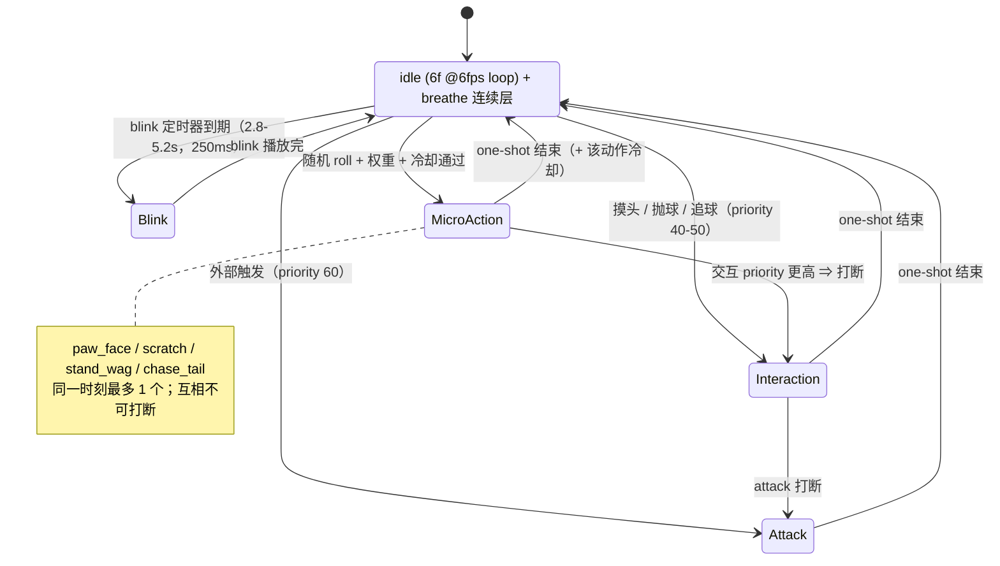

# 像素桌宠动画系统设计（2026-11-18）

Status: **子任务交付稿（动画子系统 + 占位帧 + 测试；未接入 main.ts / pet.html / pet.css / hero-runtime.ts）**。
实现仓：`desktop-games`；代码 `src/pet/anim/**`、占位资产 `public/assets/pet/anim/**`、生成器 `scripts/gen-pet-anim-frames.py`、测试 `tests/pet-anim.test.ts`。
目标：把“待机几乎不动”的桌宠升级成 2D 像素动作游戏式动画——基础待机循环（呼吸起伏 + 眨眼）+ 随机/间断微动作（前腿摸脸、后腿挠痒、站起摇尾、追自己尾巴）+ 交互（摸头、抛球后追球），并先锁定帧数/帧率与美术替换契约。

---

## 0. 结论（先看这里）

1. **动画分层**：`breathe`（连续呼吸偏移）+ `idle`（6 帧 / 6 FPS 循环）+ `idle_blink`（3 帧眨眼叠层/替换，250ms）+ 由 **确定性种子调度器** 触发的随机微动作 + 外部交互 one-shot（摸头/抛球/追球/攻击）。
2. **帧率按研究建议锁定**（测试强制）：idle 4-8 FPS / 2-8 帧、walk 8-12 FPS / 6-8 帧、run 10-16 FPS / 6-8 帧、attack 12-24 FPS **非均匀节奏**（蓄力慢 / 命中 2 帧 / 收招中速，每帧局部帧率仍在 12-24）。全部 clip 共 12 个、每角色 68 帧。
3. **占位美术**：脚本确定性生成 96×96、硬 alpha、1px 闭合轮廓、≤20 色的 dog / cat / human(汀岚风) 三套包；每个动作都能从帧上看出来。运行 `python3 scripts/gen-pet-anim-frames.py --check` 可复验字节。
4. **manifest 与现有 hero pack 兼容**：顶层 `canvas/anchor/footBox/tags/assets` 用 `hero.ts validateCharacterPack()` 可加载；额外 `anim` 块保存 duration/layer/priority/holdMs/FPS 频段/tracks/气泡策略。测试用 `loadCharacterPack()` 实际加载过三套包。
5. **气泡/语音规则**：人形 = 实心气泡 + 允许 TTS（speech）；猫/狗 = 空心气泡 = 心理活动（thought），**永不进 TTS**。策略是严格的：给猫/狗请求 speech 气泡会抛 `AnimationError`。
6. **接入点留白**：本任务不改运行时代码；§8 给出可落地的 hero 接入步骤（推荐“叠加 canvas”方案）与后续 `HeroRuntime` 增量 API 建议。

---

## 1. 现状研究（2026-11-18 复核）

| 现状 | 事实 | 对本设计的影响 |
|---|---|---|
| `src/pet/hero.ts` | `CharacterTag = { frames, fps, loop, phase? }`；`frameIndexFor()` 是**均匀**采样（`floor(elapsed/1000*fps)`，loop 取模、one-shot 钳最后一帧）；`CharacterRenderer.play(tag)` 同一时刻只播一个 tag，自带 rAF 循环 | 兼容包必须仍是 flat tags/assets；**非均匀 attack 只能近似**；v0.1 用“替换式眨眼”而不是真图层合成 |
| `src/pet/hero-runtime.ts` | `HeroRuntime` 由 `SceneRuntime` 行为状态驱动 tag；宿主 `main.ts` 提供 canvas/rAF，每帧 `tick()` + `render()`；`emit()/speak()` 转发事件；`actorFrame()` 可查当前 tag/frame | 接入点明确：动画调度器应运行在宿主帧循环里，与 SceneRuntime 的“高级状态”分层，见 §8 |
| `src/pet/character/behavior.ts` | `mulberry32` + 规则/冷却/权重 ambient；FCI 行为档案的 state 均有固定 tag（idle/pat/talk/...） | 复用同一 PRNG 算法，行为轨迹与动画轨迹可对齐；pat 行为的 3000ms 冷却可直接复用 |
| `src/pet/character/runtime03.ts` | FCI 0.3 预览已有 `idle.variants` 加权微动作 + anti-repeat（每 12-30s 一次） | 本设计是它的“可播放帧 + 视觉层”落地版：权重、冷静期、anti-repeat 语义一致 |
| `public/assets/pet/{dog,cat,pearl}-placeholder/manifest.json` | 96×96、anchor 48/96 foot-center、footBox `-36,-18,72,18`、7 tags / 36 帧、idle 8 帧 @8 FPS、placeholder-only、ai none | 动画包沿用同一画布/锚点/脚盒与占位许可；画布保持 96 便于 hero 立即兼容 |
| `public/assets/pet/tinglan-256/` | 256×256、同一锚点语义（128/256、foot-center）、49 帧、orca-pixel 调色、蓝眼黑发西装 | human 占位采用汀岚风配色/眼镜/蓝 bow/黑西装/小 orca 尾；未来 256 美术沿用同一锚点比例 |
| 测试风格 | `node --import tsx --test tests/*.test.ts`；纯 Node + `node:fs`/`node:zlib` 自解 PNG，无浏览器 | 新测试零新增依赖，PNG 头/IDAT/像素均为本地解码 |

**未被本任务修改**：`src/pet/main.ts`、`pet.html`、`pet.css`、`src/pet/hero-runtime.ts`，以及仓库里 3 个与本任务无关的既有未提交改动。

---

## 2. 分层模型与状态机

### 2.1 轨道（Track）

| Track | 内容 | 播放语义 |
|---|---|---|
| `base` | idle / walk / run + 所有 one-shot（pat_head、ball_throw、ball_chase、paw_face、scratch、stand_wag、chase_tail、attack） | 主画布同一时刻一个 clip；one-shot 结束回 idle |
| `overlay` | `idle_blink`（3 帧 @12 FPS，250ms） | v0.1 渲染器无合成能力 ⇒ 作为“250ms 全身替换”播放（呼吸暂停一瞬，肉眼可接受）；未来合成器可裁成眼睛区域真叠层 |

### 2.2 状态机



优先级（数值大者可在 `trigger()` 中打断正在播放的 one-shot；随机微动作只在无 one-shot 时开火）：

| clip | priority | 说明 |
|---|---:|---|
| idle | 0 | 基础循环 |
| walk | 5 | 未来漫游用，当前由外部控制 |
| idle_blink | 10 | 叠层，one-shot 自动压制/取消 |
| run | 15 | 未来漫游/追球过渡 |
| paw_face / scratch / stand_wag / chase_tail | 20 | 随机微动作池 |
| ball_throw | 40 | 抛球手势 |
| ball_chase | 45 | 追球冲刺 |
| pat_head | 50 | 摸头（与 FCI 行为 `pat` 的 priority 50 对齐） |
| attack | 60 | 可选战斗动作，只能外部触发，不进随机池 |

> 与现有 `SceneRuntime` 的边界：**高级状态（drag/land/talk/remind/sleep）仍归行为层**；动画调度器只在行为层处于 idle 类状态时运行随机微动作与眨眼（见 §8 的 host gate）。

---

## 3. Clip / 帧表（研究建议的落实）

同一套计时被 dog / cat / human 共用（美术姿态不同），保证调度器与交互层角色无关。表中 duration 为真实时长（one-shot 播完自动回 idle；loop 取模）。

| clip id | 帧数 | FPS | duration | loop | layer | 建议区间 | 用途 |
|---|---:|---:|---:|---|---|---|---|
| `idle` | 6 | 6 | 1000ms | ✅ | base | idle 4-8 FPS / 2-8 帧 | 蹲坐呼吸、耳/尾微摆 |
| `idle_blink` | 3 | 12 | 250ms | ❌ | overlay | 叠层（不受 idle 区间约束） | 半闭→闭→半闭 |
| `walk` | 8 | 10 | 800ms | ✅ | base | walk 8-12 FPS / 6-8 帧 | 四足小跑/人形摆臂走 |
| `run` | 6 | 14 | 429ms | ✅ | base | run 10-16 FPS / 6-8 帧 | 追球/兴奋冲刺 |
| `pat_head` | 4 | 8 | 500ms | ❌ | oneshot | 8-12 FPS | 摸头开心（眯眼+脸红） |
| `ball_throw` | 5 | 10 | 500ms | ❌ | oneshot | 8-12 FPS | 人形蓄力→出手；猫狗为推球变体 |
| `ball_chase` | 6 | 12 | 500ms | ❌ | oneshot | 8-12 FPS | 冲刺→扑球（末帧压低身体） |
| `paw_face` | 5 | 8 | 625ms | ❌ | oneshot | 8-12 FPS | 前腿摸脸/人形手托腮 |
| `scratch` | 6 | 8 | 750ms | ❌ | oneshot | 8-12 FPS | 后腿挠痒/人形挠头，带抖动 |
| `stand_wag` | 6 | 8 | 750ms | ❌ | oneshot | 8-12 FPS | 坐→站 + 快速摇尾/人形伸懒腰 |
| `chase_tail` | 6 | 10 | 600ms | ❌ | oneshot | 8-12 FPS | 追自己尾巴（尾巴扫到身前 + 旋转线） |
| `attack` | 7 | 16（近似） | 439ms | ❌ | oneshot | attack 12-24 FPS / 非均匀 | 蓄力→命中→收招；可选 |
| **合计** | **68** | — | — | — | — | — | 每角色 68 帧，3 角色 = 204 PNG |

### 3.1 attack 非均匀节奏（唯一 non-uniform clip）

`holdMs = [83, 83, 63, 42, 42, 63, 63]`（总和 439ms）：

| 帧 | 语义 | hold | 该帧局部 FPS | 说明 |
|---:|---|---:|---:|---|
| 0 | charge 起 | 83ms | 12.05 | 蓄力慢 |
| 1 | charge 满 | 83ms | 12.05 | 蓄力慢 |
| 2 | 预备出手 | 63ms | 15.87 | 过渡 |
| 3 | 命中 | 42ms | 23.81 | 1-2 帧快帧 |
| 4 | 命中/反冲 | 42ms | 23.81 | 1-2 帧快帧 |
| 5 | 收招 | 63ms | 15.87 | 中速 |
| 6 | 收招落定 | 63ms | 15.87 | 中速 |

整体有效帧率 = 7 / 0.439 ≈ **15.95 FPS**，落在 12-24；`fps: 16` 是给 `hero.ts` 均匀采样近似的基率（7/16 = 437.5ms，与真实 439ms 差 1.5ms / 0.34%）。**未来渲染器应读取 `holdMs`**；现有 hero 只能近似。

### 3.2 角色差异（同一计时、不同姿态）

> **默认犬种 = 金毛寻回犬（golden retriever，2026-11-18 重绘）**：暖金主色 + 奶油口吻/胸毛/腿羽 + 深金垂耳 + 宽圆吻 + 友好棕眼 + 羽状尾；坐姿为金毛式蹲坐（宽胸、直前腿、脚型圆润）。所有四足/抬爪/挠痒/追球帧的爪子都是“圆爪 + 2 个暗像素趾缝”，不是尖爪、蹄状或贴在腿端的圆球。cat / human 本轮未重绘。


| clip | dog | cat | human（汀岚风占位） |
|---|---|---|---|
| idle | 蹲坐看向镜头，呼吸 ±1px + 耳朵/尾巴轻摆 | 同狗，尖耳/长尾 | 站立呼吸，头发/黑西装轻微摆动，蓝 bow + orca 小尾 |
| idle_blink | 半闭→闭→半闭 | 同狗 | 同（眨眼经眼镜可见） |
| walk | 交替抬前/后腿 + 身体起伏 | 同狗 | 摆臂 + 交替迈腿 |
| run | 抬升身体、尾巴上扬、运动线 | 同狗（耳朵/长尾收拢防出画） | 前倾、摆动更大、头发后飘 |
| pat_head | 眯眼 + 脸红 + 尾巴快摇 + 星光 | 同狗 | 歪头 + 眯眼 + 脸红 + 星光 |
| ball_throw | 前腿推地上的球（ball 道具烘焙进帧） | 同狗 | 蓄力→右手抛出，球在手中/飞出（烘焙） |
| ball_chase | 冲刺→压低扑球，球滚到爪边 | 同狗 | 跑向滚来的球 + 伸手 |
| paw_face | 前腿抬到脸颊 | 同狗 | 手托腮（思考） |
| scratch | 后腿抬起挠肚子，身体左右抖 | 同狗 | 手挠头 |
| stand_wag | 坐→站 + 尾巴快速左右甩 | 同狗 | 站起伸懒腰 + 摆 orca 尾 |
| chase_tail | 尾巴扫到身前、身体旋转、旋转线 | 同狗 | 转身追自己的 orca 尾（旋转线） |
| attack | 压身→前扑咬（张嘴） | 压身→挥爪（露爪） | 蓄力→左拳/手刀前击 + 冲击线 |

> 占位约定：球、星光、运动线/冲击线、旋转线都烘焙进对应帧，**便于 96px 一眼看懂动作**；正式美术若把球做成场景独立 sprite，需要把这些烘焙道具从帧里去掉（见 §9）。

---

## 4. 随机调度参数（`IdleAnimationScheduler`）

实现：`src/pet/anim/idle.ts`。纯函数式确定性：只吃宿主提供的单调 `nowMs`，不读墙钟、不用 `Math.random()`；同 seed + 同 tick 序列 ⇒ 逐事件完全一致（测试用 golden trace 断言）。

| 参数 | 默认值 | 说明 |
|---|---|---|
| PRNG | mulberry32（同 `behavior.ts`） | `seed` 必填；也可注入 `rng()` 测试 |
| warmup（安静期） | 8-15s（随机区间内取一值） | 启动/交互后先纯待机，避免一上线就演动作 |
| roll 间隔 | 10-22s | 每个 roll 尝试挑一个 ready 的微动作 |
| 无候选 retry | 2-6s | 全部在冷却时短退避 |
| 微动作权重 | paw_face 30 / scratch 20 / stand_wag 30 / chase_tail 20 | `weights` 可覆盖（测试用 1:9 验证分布） |
| 单动作冷却（从动作结束算） | paw_face 45-75s；scratch 60-100s；stand_wag 90-150s；chase_tail 120-200s | 每个动作结束抽一次区间值，防止刷屏 |
| anti-repeat | 开 | 有 >1 个候选时不连续重复同一动作 |
| 眨眼间隔 | 2.8-5.2s（每次眨眼 250ms） | 眨眼是 overlay，one-shot 期间被压制/取消 |
| 呼吸 | period 3200ms、amplitude ±1px、整像素 | 连续层：`breatheOffsetPx(t) = round(sin(2π t/period)·amp)` |
| 时钟策略 | 单调钳制；tick 间隔再大也只补一次结束事件 | 后台 tab 节流时建议宿主 `visibilitychange` 暂停并在恢复时从当前 now 继续 |

调度器输出（`tick(nowMs)`）：

```ts
{
  nowMs, baseClip: 'idle', breatheOffsetPx,
  action: { clip, frame, frames, elapsedMs, durationMs, startedAtMs, endsAtMs, reason } | null,
  blink:  { clip: 'idle_blink', frame, ... } | null,
  events: [{type:'action.start'|'action.end'|'blink.start'|'blink.end', ...}]
}
```

外部交互：`trigger(clip, nowMs, reason='interaction')` 只接受 one-shot；优先级更高会打断当前动作（`action.end reason:'interrupted'`），同级/更低返回 `{ok:false, reason:'busy:...'}`；loop/overlay clip 直接抛错。宿主只应在行为层 idle 时推进随机层（见 §8）。

---

## 5. 交互流程

### 5.1 摸头

1. 指针 `pointerdown` 命中 actor 画布上部约 40% 区域（头），或右键菜单“摸摸”。
2. 宿主：行为层 `hero.emit('pat')`（保留现有 FCI 语义）；动画层 `scheduler.trigger('pat_head', now)`。
3. 播放 `pat_head` 4 帧 @8 FPS（500ms）→ 自动回 idle；同 actor 建议 3000ms 冷却（复用 behavior `pat.cooldownMs=3000`）。
4. 气泡：人形 → speech（实心，可 TTS，现有 voice line `pat_a`“嗯。”）；猫/狗 → thought（空心，无 TTS，取行为档案 speech.lines 里带括号的心理活动，如 dog “（把脑袋塞进你手心）”）。

### 5.2 抛球 → 追球

宿主动作按钮/手势触发 `planBallFetch(thrower, chaser)`（`src/pet/anim/interactions.ts`）：

```
t=0ms      thrower human：ball_throw（5 帧 @10 FPS，500ms）
t=0ms      ball 作为场景道具从手部飞出（轨迹归宿主/未来 ball 物理层）
t=820ms    chaser dog/cat：ball_chase（6 帧 @12 FPS，500ms）
           （= 抛球 500ms + 默认飞行/落地 320ms）
t=1320ms   追球结束回 idle；球道具可淡出/消失
```

- `planBallThrow(character)` / `planBallChase(character)` 也可单独使用；`validateInteractionPlan()` 校验所有 step 的 clip 存在、时长一致、气泡语义合法。
- 抛球与追球是两个 actor 的动作；本任务只交互动“计划数据”，不实现球物理、不实现跨 actor 同步（留给场景层）。
- 人类/人形是否参与追球：占位阶段三者都有 `ball_chase` clip；产品上建议“仅猫/狗追球，人形作为抛球者”（待拍板，见 §11）。

### 5.3 其他交互

- 攻击 `attack`：不进随机池，只能由外部事件 `scheduler.trigger('attack', now)`；用于未来“被戳/护食/玩闹”场景。
- 拖拽/落地/说话/提醒/睡眠：沿用现有 FCI 行为状态与 tag，不归本调度器；调度器应在这些状态下暂停随机动作（只保留呼吸；睡眠建议改用 sleep tag，不跑 idle 呼吸）。

---

## 6. 气泡与语音规则

实现：`src/pet/anim/bubbles.ts`。**严格策略**：角色只能使用其允许的气泡语义，非法请求抛错（未来接入 bug 不会静默把猫狗送进 TTS）。

| 角色 | 可用语义 | 气泡外观 | TTS/语音 | aria-live | 最大字数 | 失败行为 |
|---|---|---|---|---|---:|---|
| human（人形/汀岚） | **speech** | 实心 `bubble--solid` | ✅ 允许（仍受现有 L0-L3 语音门/静音/配额约束） | polite | 120 | 请求 thought ⇒ `AnimationError` |
| cat / dog | **thought**（心理活动） | 空心 `bubble--hollow` | ❌ 永不 TTS | off | 40 | 请求 speech ⇒ `AnimationError` |

- `bubbleForEvent(character, 'pat.head' | 'pat.body' | 'ball.throw' | 'ball.chase')` 返回 `BubblePlan { character, semantic, spec, textTag, lineId? }`；人形 `pat.head` 附带现有 voice line id `pat_a`。
- 宿主渲染时只应用 CSS class（`bubble--solid`/`bubble--hollow`），**本任务不改 pet.css**；语音只对 speech 且 `voiceAllowedFor(spec)===true` 的 plan 调 TTS。
- 猫狗现有行为档案里的 `speech.lines`（例如“（尾巴摇成了螺旋桨）”）本质是心理活动文本，必须映射到 thought/空心；不得把它们送 TTS。
- 现有语音门 `CharacterRuntime03.gateSpeech()`（L0/L3 不发声、mute、gap、配额、line dedupe）仍是唯一 TTS 出口；本模块只提供语义判断，不绕过门。
- **manifest 也固化该契约**：每个包 `anim.voice = { mode, canTts, bubble }`。human/humanoid 为 `{mode:'tts', canTts:true, bubble:'speech'}`；cat/dog 为 `{mode:'none', canTts:false, bubble:'thought'}`。`validateAnimManifest()` 会拒绝任何把猫/狗改成 tts/speech、或把人形降级为 none 的 manifest（测试覆盖双向漂移）；`VOICE_CAPABILITIES` 是代码侧单一事实源。

---

## 7. 占位资产与 manifest

### 7.1 目录与命名

```
public/assets/pet/anim/<character>/manifest.json
public/assets/pet/anim/<character>/<clip>/<clip>_NN.png     # NN = 00..(frames-1)，两位补零
# character ∈ { dog, cat, human }，clip ∈ §3 的 12 个 id
```

例如 `dog/ball_chase/ball_chase_03.png`。生成的 `manifest.json` 顶层仍是 hero CharacterPack（`id/style/canvas/anchor/footBox/palette/tags/assets/license/ai`），**额外**：

```jsonc
"anim": {
  "contract": "famling.pet-anim/0.1",
  "character": "dog",
  "framePattern": "<clip>/<clip>_NN.png",
  "clips": { "idle": { "frames": 6, "fps": 6, "loop": true, "durationMs": 1000,
                        "layer": "base", "category": "idle", "priority": 0, "dir": "idle" }, ...,
             "attack": { ..., "holdMs": [83,83,63,42,42,63,63] } },
  "fpsBands": { "idle": {...}, "walk": {...}, "run": {...}, "attack": { ..., "nonUniform": true } },
  "randomMicroActions": ["paw_face","scratch","stand_wag","chase_tail"],
  "tracks": { "base": [...], "overlay": ["idle_blink"] },
  "bubblePolicy": { "speech": "solid", "thought": "hollow" },
  // human/humanoid（汀岚）: { "mode": "tts", "canTts": true,  "bubble": "speech" }
  // cat/dog（不配 DeepSeek 语音）: { "mode": "none", "canTts": false, "bubble": "thought" }
  "voice": { "mode": "none", "canTts": false, "bubble": "thought" }
}
```

- 校验入口：`src/pet/anim/manifest.ts validateAnimManifest()`（纯数据、无 DOM、无 hero 依赖）；测试另外用 `hero.ts validateCharacterPack()` + `loadCharacterPack()` 证明 hero 兼容。
- 与现有 hero 包映射：`hero.play(tag)` 的 tag 名 = clip id；`assets` 顺序 = clip 顺序（同 tags 插入顺序）；attack 用 `fps:16` 均匀近似 439ms。
- 画布/锚点/脚盒：`96×96`、anchor `{x:48,y:96,mode:'foot-center'}`、footBox `{x:-36,y:-18,w:72,h:18}`，与 `dog/cat-placeholder` 完全一致；human 未来 256 目标见 §9。

### 7.2 生成器

`scripts/gen-pet-anim-frames.py`（python3 + PIL + numpy，均为 `gen-pet-placeholder.py` 已用依赖，**无新增 npm 依赖**）：

- 纯整数图元 + 固定姿态表，无随机、无网络、无模型；硬 alpha、1px 闭合轮廓（numpy 边界检测）、每帧 ≤20 色（测试检查）。
- 姿态表覆盖：呼吸、眨眼、四足/人形 walk、run、摸头、推/抛球、追球、摸脸、挠痒、站起摇尾、追尾、攻击（含非均匀 hold 元数据）。
- 防裁切：脚本生成后测试检查所有 204 帧 bbox 不触画布边缘（猫尾/尖耳/犬尾已调参）。
- 命令：
  - `python3 scripts/gen-pet-anim-frames.py`（三套包）
  - `--only dog|cat|human`
  - `--check`（逐字节复验，等价于“生成器 = 盘上资产”）
  - `--only dog --sheet /tmp/dog.png`（人工评审用 contact sheet，不写资产）
- 脚本会清理对应 clip 目录里过期的 `*.png`，不碰其他文件；**不要手改 PNG**（会被 --check / 测试判 STALE）。

---

## 8. hero 接入步骤（本任务未改运行时代码，供后续实现者执行）

前提：动画调度器是 headless 的；接入 = 在宿主帧循环里驱动它，并把结果映射到渲染。

### 8.1 推荐方案 A：叠加一个动画 canvas（零改动现有文件）

1. 在 `pet.html` 的 hero stage 里叠一个同布局的 `<canvas id="pet-anim-canvas">`（与 `#hero-canvas` 同尺寸/同 `image-rendering: pixelated`；z-index 在 hero canvas 之上）——**需后续 owner 改 pet.html/pet.css，本任务不动**。
2. 用现有 `hero.ts CharacterRenderer` 加载 `/assets/pet/anim/<character>/`（或复用 `loadCharacterPack` + `renderStill(tag, frame)`），按 hero 的 layout slot 计算绘制位置（与 `HeroRuntime` 相同的 actor x/y/scale）。
3. `main.ts startHeroLoop` 的 rAF 里：`const tick = scheduler.tick(now)`；有 `action` 时 `renderer.renderStill(tick.action.clip, tick.action.frame)`，有 `blink` 时渲染 `idle_blink` 帧，否则清空叠加 canvas（hero 自己画 idle 循环）。呼吸连续层：若采用叠加 canvas，建议 idle 改用“中性首帧 + `breatheOffsetPx` 整体 1px 位移”，或在烘焙帧模式下忽略偏移（二选一，不要叠加两次呼吸）。
4. 交互：命中头部区域 → `scheduler.trigger('pat_head', now)` + `bubbleForEvent(character,'pat.head')` + 现有 TTS 门；抛球按钮 → `planBallFetch`，t=820ms 时对 chaser `scheduler.trigger('ball_chase', t)`。
5. QA：把 `scheduler.snapshot()` 挂到 `window.__pet.qa.anim`（未来）；用 tick 事件序列做回放测试，不依赖墙钟。

### 8.2 方案 B：HeroRuntime 增量 API（后续小改 hero-runtime.ts）

- 给 `HeroRuntime` 加 `renderOverride(actorId, { tag, elapsedMs })`（或 tick 返回 render hint），让宿主在不破坏 SceneRuntime 状态的前提下临时用动画包的 tag/frame 渲染。
- 该改动很小但属于现有仓主路径，建议等方案 A 验证体验后再做；**本任务明确不改 hero-runtime.ts**。

### 8.3 host 状态门（重要）

调度器只应在“行为层 idle 类状态”推进随机动作/眨眼：

```ts
const sceneState = hero.scene.get(actorId).state  // idle/pat/drag/land/talk/remind/sleep
const animActive = sceneState === 'idle'
if (animActive) animTick = scheduler.tick(now)
// 进入 drag/talk/remind/sleep：暂停 scheduler（不要 trigger 随机动作）；
// 回到 idle：若距上次 tick 很久，直接 tick(now)（内部单调钳制，不会补播一堆动作）
```

### 8.4 资产与缓存

- Vite `public/` 直接服务：dev/prod 路径均为 `/assets/pet/anim/<character>/`；Tauri 打包静态资源同样路径。
- 204 PNG ≈ 264KB（dog 89KB + cat 93KB + human 88KB，含 manifest），对桌宠窗口可忽略；manifest 与帧都可按 `?v=<pack version>` 或构建 hash 做缓存失效（未来）。
- 三套包均为 placeholder-only / ai=none；正式替换前不要对外当成品宣传。

---

## 9. 未来美术替换契约

1. **尺寸/锚点/脚盒**：保持“脚底中心”语义。`anchor = (canvasW/2, canvasH)`、`footBox = (-0.375W, -0.1875H, 0.75W, 0.1875H)`（96 时即 `-36,-18,72,18`；256 时 `-96,-48,192,48`，与 `tinglan-256/manifest.json` 完全一致）。**不要用 96→256 直接整数放大**（2.667× 非整数）；256 需按 canvasTarget 重绘。
2. **命名**：`<character>/<clip>/<clip>_NN.png`、两位补零、帧数/顺序与 §3 一致；一角色一个 manifest。
3. **必须保留的契约**：12 个 clip id 与顺序；`frames/fps/loop/durationMs/layer/category/priority`；attack 的 `holdMs`（若改帧数必须同步改 `src/pet/anim/clips.ts`、生成器、manifest 与测试）；`idle_blink` 仍是 overlay/one-shot；气泡策略（实心 speech/空心 thought）不变。
4. **美术要求**：硬 alpha（0/255，不做半透明）；1px 闭合轮廓（`#0b1220` 或该角色 outline 色）；透明安全边距（任何帧不贴画布边）；每帧 ≤40 色（版式/可读性政策；占位 ≤20）；不使用 AI 生成图除非按现有 AI 标识流程标注（占位为 ai none）。
5. **替换流程**：把终稿 PNG 放到同路径 → 更新 manifest `palette/license/ai.status/placeholder/generator`（final 时 `placeholder:false`、`ai.status` 按真实情况）→ 跑 `node --import tsx --test tests/pet-anim.test.ts`、`npm run typecheck`、`python3 scripts/gen-pet-anim-frames.py --check`（若保留生成器；终稿不再生成则删掉 --check 依赖并在文档更新）→ 人工 contact sheet 评审 → 视觉走查（2× 桌宠窗口）。
6. **道具分离**：正式版建议球/星光/运动线从角色帧中剥离，球作为场景 sprite（有物理/轨迹），角色帧只留身体动作；本占位把道具烘焙进帧是产品评审可读性优先的临时约定。
7. **新增 clip**：v0.1 validator 锁定“恰好 12 个 clip id”；加动作需要升 `famling.pet-anim/0.2` 契约并同步 manifest/测试，不能悄悄多文件。

---

## 10. 测试与验证（2026-11-18 实测）

`tests/pet-anim.test.ts`（node:test，16 个用例，无浏览器/网络/时钟依赖）：

- 帧表：FPS/frame 区间、loop/layer、attack 非均匀（hold/localfps/effective/charge>hit/recovery medium）；
- 时间线：均匀 clip 与 `hero.ts frameIndexFor()` 逐点一致；one-shot 钳制、loop 回绕、attack hold 边界；
- manifest：`validateAnimManifest` 通过、与代码帧表逐字段一致、篡改/漂移必失败；`validateCharacterPack` 兼容、`loadCharacterPack` 真加载（nested 路径）；
- 磁盘：204 帧存在且仅存在契约文件、PNG 96×96/8-bit RGBA/硬 alpha/透明角/不贴边/≤20 色、总帧数 68/角色；
- 视觉：idle≥3 种帧（呼吸）、blink 3 帧且与 idle 不同、动作帧与 idle 不同、attack 7 帧全不同；
- PRNG/调度器：确定性 trace、warmup 静默、权重分布（1:9 验证）、冷却间隔、anti-repeat、眨眼节奏/帧序列/呼吸周期、trigger 优先级打断/拒绝、循环 clock 钳制；
- 气泡：人类 speech 实心+可语音+aria；猫狗 thought 空心+不可语音；非法语义抛错；事件→气泡映射；
- 语音契约：只有 human/humanoid 可 speech+TTS；cat/dog 的 `VOICE_CAPABILITIES`/`BUBBLE_POLICIES`/`manifest.anim.voice` 三处都固定 `none`+`canTts:false`+`thought`，manifest 篡改双向拒绝；
- 交互：摸头/抛球/追球/联合 fetch 计划、气泡语义、坏计划校验、非法参数抛错；
- 覆盖：dog/cat/human 三套 manifest+目录+逐帧存在且互不相同。

实测命令与结果：

```bash
cd /mnt/d/Projects/dsh/desktop-games
npm run typecheck                                  # tsc --noEmit，通过（0 error）
node --import tsx --test tests/pet-anim.test.ts    # 16 tests, 16 pass, 0 fail
python3 scripts/gen-pet-anim-frames.py --check     # check ok: dog + cat + human animation packs match the generator
```

（占位帧非最终美术；本报告不声称做过真人视觉验收，只做了 contact sheet 人工目视核对。）

---

## 11. 风险 / 未完成 / 待拍板

| # | 风险/未完成 | 缓解/下一步 |
|---|---|---|
| 1 | **真叠层合成缺失**：现有 `CharacterRenderer` 一次只画一个 tag，眨眼是 250ms 替换而非真 overlay | v0.1 接受；方案 A 叠加 canvas 后可做真叠层；attack 的 holdMs 也需未来 backend 支持 |
| 2 | **非均匀 attack 只能近似**：`hero.ts` 均匀 fps，7/16=437.5ms vs 真实 439ms | 0.34% 误差可接受；正式接入时应给 backend 加 holdMs 时间线 |
| 3 | **两套状态系统可能打架**：SceneRuntime（pat/talk/drag/sleep）vs 动画调度器 | host gate：调度器只在 scene idle 时推进随机层；交互事件双写（behavior + anim）需明确顺序 |
| 4 | **占位美术可读性有限**：1-2px 呼吸在 2× 窗口较微妙；猫狗尾巴/人形眼镜在小尺寸的辨识度靠配色 | contact sheet 已检查动作差异；正式美术替换后需重跑视觉走查；必要时加大呼吸振幅（但不得改变帧率区间） |
| 5 | **烘焙道具约定**：球/星光/运动线在帧内，正式分离球 sprite 时会出现双重影子 | §9.6 已列为替换契约；接入球物理前先定“帧内不画球” |
| 6 | **manifest 冻结 12 clip**：加动作必须升契约版本 | 有意为之；见 §9.7 |
| 7 | **256 人形美术尚未生成**：当前 human 占位 96，锚点/脚盒比例已按 256 契约给出 | 未来按 `canvasTarget: 256` 重绘；不能把 96 放大 |
| 8 | **交互决策待拍板**：人形是否参与追球；猫狗是否允许攻击；摸头冷却/语音频率 | 产品拍板后只改 `interactions.ts` 计划与文档，不动既有 UI |
| 9 | **后台节流**：rAF 暂停/恢复时时钟跳变 | 调度器已做单调钳制 + 事件合并；宿主仍应在 `visibilitychange` 时暂停并在恢复时 tick(now) |
| 10 | **未接 UI/未跑浏览器**：本任务不改 main.ts/pet.html/pet.css/hero-runtime.ts，未做浏览器回归 | 接入方案见 §8；接入后补 hero-runtime / 浏览器 e2e 测试（属于后续任务） |
| 11 | **法务/资产状态**：占位 license = placeholder-only、ai none | 正式化前更新 LICENSE/ASSET-LICENSES/AI-PROVENANCE（归主任务） |

---

## 12. 文件清单（本任务新增）

```
src/pet/anim/
  types.ts          Clip/Track/FrameSpec/BubbleSemantic/FPS_BANDS/AnimationError
  prng.ts           mulberry32 + createRng（确定性、可注入）
  timeline.ts       hold/duration/frameIndex/frameFile/clipSpecProblems
  clips.ts          12 clip 帧表 + validateClipTable()（帧率区间强制）
  manifest.ts       famling.pet-anim/0.1 manifest 校验 + 路径/资产清单
  bubbles.ts        实心 speech / 空心 thought 严格策略 + 事件映射
  idle.ts           IdleAnimationScheduler（blink/breathe/随机/冷却/触发）
  interactions.ts   摸头/抛球/追球/联合 fetch 计划 + 校验
  index.ts          barrel（ANIM_MODULE_VERSION = 0.1.0）
scripts/gen-pet-anim-frames.py
public/assets/pet/anim/{dog,cat,human}/manifest.json + <clip>/<clip>_NN.png（各 68 帧）
tests/pet-anim.test.ts
docs/design/PET-ANIMATION-2026-11-18.md   ← 本文件
```

## 10. 金毛占位美术 v7（2026-11-18，三轮子代理评审后定稿）

- 默认犬种按用户要求改为**金毛寻回犬**；正面坐姿/侧面站姿两套骨架按 `REVIEW-ANATOMY.md` §7A/§7B 的比例绘制：正面头骨 26×20、吻 16×9、眼距 12、耳根 y=20、肩线 y=45/臀线 y=78、前腿 7px、前爪 10×7；侧面背线 y=36、brisket y=63、前腿 shoulder→elbow→wrist→pastern→paw、后腿 hip→knee→hock→pastern→paw、远腿 dx=-3。
- 爪子三形态按 §6：正面 10×7（2 条 shade 趾缝、底边轮廓、爪宽/腿宽=1.43）、侧面 12×6（前缘比腿前伸 2px）、抬爪 8×10（1px shade 包边、3 趾垫/趾缝、两段前臂）；后爪只露 2-3 列并有 1px 缝。
- 全部 68 帧：唯一帧 68/68、底边 y=89、硬 alpha、≤14 色、1px 闭合外轮廓、无封闭透明洞、内部黑线 0；idle 爪区逐帧 diff=0；walk 8 帧每帧恰好 1 脚离地；run 2 帧真腾空；attack 7 帧唯一且不穿地。
- 评审流程：3 个子代理先审 v4（解剖/动作/像素，P0 共 21 条），按 REVIEW-ANATOMY §6/§7 重绘 v6；3 个子代理复审 v6（P0 全部关闭，剩余 P1）；再按复审做 v7 最小补丁（侧视垂耳/停、右耳镜像、FX 描黑、双尾、walk 支撑相位、后爪缝、尾羽、抬爪、stand 后腿、奶油领）。
- 评审材料：`_scratch/pet-anim-review-v4/`（3× REVIEW）、`_scratch/pet-anim-review-v6/`（3× REVIEW-V6）；预览：`_scratch/pet-anim-v7-preview/`（1x/4x contact sheet + 12 GIF + METRICS-v7.md）。
- 仍为占位美术：尾羽/卷尾/侧吻/抬爪仍是简化像素；P2（run 头摆、stand 回坐单帧、chase_tail 斜带感、球被爪遮等）待正式美术或接入阶段处理。正式美术替换契约见 §9。

## 11. 金毛占位美术 v8 打磨（2026-11-18，第二轮用户反馈）

- **重复肢体审计/修复**：`front_legs()` 抬爪侧判断修复（`raised_front` 是元组，"left"/"right" 比较永远为假 → 抬左前爪时地面左前爪仍被画）；`front_hind()`/`front_scene()` 新增 `hide_hind_paw`，scratch 抬右后腿时隐藏同侧后爪；attack f3/f4 增加右前爪前挥。实测 paw_face 01–04 / ball_throw 01–03 / scratch 01–04 / attack 03–04 地面同侧爪全部消失，68 帧 0 处同侧肢体重复（audit 脚本见预览目录）。
- **侧视 walk/run**：远腿由向前 −3px 改为向后 +3px（不再跑到近腿前面）；肘/腕/膝/跗/后系增加 2–3px shade 关节；侧吻 stop 1px→2px、口吻 `light #f2cf87`、垂耳 flap 10×16 画在头骨之后（外缘 x=38、ear_inner 32px）、耳顶 1px light 毛边、3×3 眼 + 1px 高光；尾主干 8/7/5px + 4 条奶油羽。walk 8 帧仍每帧恰好 1 脚离地，run f0/f4 腾空。
- **正面脸部**：椭圆眼（上下 2px 收边）+ 深棕瞳孔 1px + 1px 白色 catch-light；耳根与头骨交界 1px 折痕；blink/half/wide/side 同步；鼻/嘴/胸毛沿用 v7。
- 门禁：`--only dog --check` ok、`tests/pet-anim.test.ts` 16/16、`tsc --noEmit` 通过；68/68 唯一帧、底边 y=89、硬 alpha、≤14 色、非 FX 轮廓缺口 0、内部黑线 0；manifest 字节不变。
- 预览与证据：`_scratch/pet-anim-dog-v8-preview/`（1x/4x contact sheet + 12 GIF + METRICS-v8.md + VERIFY-OUTPUT.txt + LIMB-AUDIT.txt）。

## 12. 金毛占位美术 v9 写实化打磨（2026-11-18，用户补发参考图 golden-user.png）

- **比例**：正面头部整体缩到 v8 的 0.88（`HEAD_SCALE`，用 96×96 临时画布最近邻缩放后贴回），侧视 0.90（`SIDE_HEAD_SCALE`）：正面头+耳 43→37px、头宽/躯干 0.91→0.79、头高/总高 35%→30%；躯干底 y=72→69（可见前腿 11→14px）；总高 76（地面 y=89 不变）。
- **头部**：垂耳缩短到下颌（耳高 20→13px、外缘仍过眼线）、黑鼻头 `#171310`（原 #2b2018 偏棕）、杏仁形深棕小眼（正面 eye 18px + 2px catch-light；侧视 3×3 + 1px 高光）、2px 额段 stop、口吻收窄（正面 16→13px、侧视 13px）；侧头同样缩到 0.90。
- **金色长毛 / feathering**：颈胸围毛（颈侧 light/belly 阶梯绒 + 胸 V 羽状尖 + 金边）、腹/腿后缘羽状饰毛（前腿后缘 1px 阶梯绒，idle 腿区 23px）、臀侧羽状绒、耳下缘/耳顶绒、额头饰毛；尾巴改为金色羽状大尾（正视 11×10 羽扇 + 5 组奶油羽、侧视 8/7/5px 蓬松尾 + 4 层奶油羽，侧视尾区奶油 16px）；侧面胸/腹/后腿共有 115px 奶油绒。
- **保持 v8 修复**：抬爪/抬腿时同侧地面肢体不重复（paw_face/ball_throw/scratch/attack 全部通过 limb audit，0 重复）；walk 8 帧每帧恰好 1 脚离地、run f0/f4 腾空；12 clip/68 帧/96×96/anchor/footBox/地线 89 全保持。
- 门禁：`--only dog --check` ok、`tests/pet-anim.test.ts` 16/16、`npx tsc --noEmit` 通过；68/68 唯一帧、底边全 89、硬 alpha、≤14 色、非 FX 轮廓缺口 0、内部黑线 0、bbox 边距 11/8/5/6；`manifest.json` 字节未变。
- 预览与证据：`_scratch/pet-anim-dog-v9-preview/`（1x/4x contact sheet + 12 GIF + METRICS-v9.md + VERIFY-OUTPUT.txt + LIMB-AUDIT.txt + measure9.py）。

## 13. 金毛项圈改为哑光砖红（2026-11-18，用户要求）

- 狗项圈由蓝色 `#2e6b9e` 改为**低饱和哑光砖红**：底色 `#a63d35`、1px 高光 `#bd5a50`、1px 暗边 `#7d2f2a`（均按 96px 调色板微调，非鲜红/非暗红）；正面项圈 3px（高光/底色/暗边）、侧视 3 行统一同一组红。
- 正面/侧视所有 68 帧（idle、walk、run、pat_head、ball_throw、ball_chase、paw_face、scratch、stand_wag、chase_tail、attack）项圈统一为红色；金色毛、奶油羽、黑鼻、棕色眼等其它颜色不变。
- 对比可读性：红 `#a63d35` 对金色毛 `#d9a251` 与阴影 `#a96a26` 均有一眼可辨的色相差，与奶油羽 `#f8ecd0` 亦有明度差；1px 轮廓/无洞不变。
- 验证：`--only dog --check` ok、`tests/pet-anim.test.ts` 16/16、`npx tsc --noEmit` 通过；68/68 唯一帧、底边 89、硬 alpha、per-frame ≤16 色（契约 ≤20）、非 FX 缺口 0、内部黑线 0、manifest 字节未变；collar 审计 68/68 帧含红、0 帧残留旧蓝。
- 预览：`_scratch/pet-anim-dog-side-v9-preview/dog_collar_8x.png`（正/侧/站立 8x + 调色板 swatch）、`dog_side_walk_run_4x.png`、`gifs/dog_walk.gif`、`gifs/dog_run.gif`、`COLLAR.md`；`_scratch/pet-anim-dog-v9-preview/` 全套 sheet/GIF 同步刷新。
